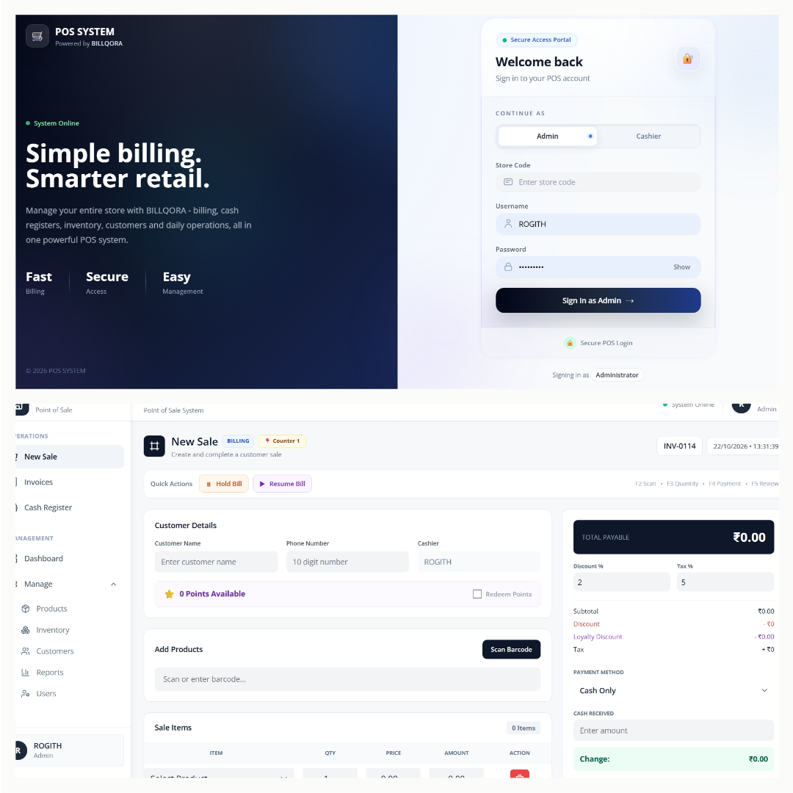

# BILLQORA — Supermarket POS & Billing Software

<p align="center">
  <a href="https://billqora-pos.netlify.app/"><strong>🌐 Live Website</strong></a>
  &nbsp; • &nbsp;
  <a href="https://github.com/Rogith01/invoice"><strong>💻 GitHub Repository</strong></a>
</p>

BILLQORA is a supermarket Point of Sale (POS) and billing application designed to simplify daily retail operations. It brings billing, inventory, customer management, cash register operations, and sales reporting together in one system, with a Windows desktop application and cloud-connected backend.

<p align="center">
  <!-- Replace this path after uploading your screenshot to the repository -->
  
</p>

<p align="center">
  
  
  
  
  
  
</p>

## 📌 Overview

Traditional supermarket billing can involve separate processes for sales, stock tracking, customer records, and register management. BILLQORA aims to bring these operations into one integrated application.

The project uses a React frontend, a Node.js and Express backend, a relational database, and Electron to package the POS application for desktop use.

**Live Website:** https://billqora-pos.netlify.app/

## ✨ Key Features

### 🧾 Billing & Sales
- Generate customer invoices.
- Calculate discounts and taxes.
- Support cash and other configured payment options.
- Review and reprint invoices.
- Generate sequential invoice numbers.

### 📦 Inventory Management
- Manage product inventory and stock quantities.
- Track low-stock items.
- Restock products and adjust inventory according to permissions.
- Support barcode scanning for faster product selection.

### 👥 Customer Management
- Maintain customer records.
- Access customer information during billing.
- Support customer loyalty features.

### 💳 Cash Register Management
- Open and close cash registers.
- Track register activity and summaries.
- Maintain register history.
- Provide separate cashier and administrator permissions.

### 📊 Dashboard & Reports
- View sales and business summaries.
- Access reporting features.
- Review billing and register information.

### ↩️ Returns & Held Bills
- Support sales return workflows.
- Hold bills and resume them later.
- Help cashiers manage interrupted transactions.

### 🏪 Multi-Store Architecture
- Organize stores using store-specific codes.
- Support store-specific database configuration.
- Use role-based access for administrative and cashier operations.

### 🖥️ Desktop Application
- Package the application for Windows using Electron.
- Provide an installable desktop experience.
- Support application update workflows through the configured updater.

## 🛠️ Technology Stack

| Layer | Technologies |
|---|---|
| Frontend | React, JavaScript |
| UI & Styling | Tailwind CSS, Lucide React |
| Backend | Node.js, Express.js |
| Database | MySQL, TiDB Cloud |
| Authentication | JSON Web Tokens (JWT) |
| Desktop Application | Electron |
| Desktop Packaging | electron-builder |
| Application Updates | electron-updater |
| Barcode Scanning | @zxing/browser |
| Invoice Printing | react-to-print |
| PDF & Image Export | jsPDF, jspdf-autotable, html-to-image |
| HTTP Requests | Axios |
| Hosting | Netlify, Render, TiDB Cloud |
| Version Control | Git, GitHub |

## 🏗️ Architecture

```text
                 ┌─────────────────────────┐
                 │    BILLQORA Website     │
                 │         Netlify         │
                 └─────────────────────────┘

┌───────────────────────────────────────────────┐
│             React POS Application             │
│                                               │
│ Billing | Inventory | Customers | Reports     │
│ Cash Registers | Returns | Barcode Scanning   │
└───────────────────────┬───────────────────────┘
                        │
             ┌──────────▼──────────┐
             │  Node.js + Express  │
             │     REST API        │
             └──────────┬──────────┘
                        │
             ┌──────────▼──────────┐
             │ MySQL / TiDB Cloud  │
             │ Store Data & Sales  │
             └─────────────────────┘

       Electron packages the POS for desktop use.
```

## 🔗 Project Links

| Resource | Link |
|---|---|
| Official Website | https://billqora-pos.netlify.app/ |
| GitHub Repository | https://github.com/Rogith01/invoice |
| Backend API | https://invoice-backend-78hd.onrender.com |
| Previous Website Deployment | https://billqora.netlify.app/ |

## ⚙️ Getting Started

### Prerequisites

Install the following tools before running the project locally:

- [Node.js and npm](https://nodejs.org/)
- [Git](https://git-scm.com/)
- MySQL or access to a configured TiDB Cloud database

### 1. Clone the repository

```bash
git clone https://github.com/Rogith01/invoice.git
cd invoice
```

### 2. Install dependencies

```bash
npm install
```

### 3. Configure environment variables

Configure the database connection, authentication secrets, and other required environment variables according to the backend configuration.

**Important:** Never commit database passwords, JWT secrets, API keys, or other sensitive credentials to GitHub.

### 4. Start the application

Use the development commands defined in the project's `package.json` files. The frontend and backend may need to be started separately, depending on the repository's scripts.

### 5. Build the Windows application

The project uses Electron and electron-builder to package the desktop application. Check the configured scripts in `package.json` before running the production build.

## 🔐 Security & Access Control

- Store-aware authentication and authorization.
- Role-based permissions for administrative and cashier operations.
- Token-based API authentication.
- Store-specific data access through the configured backend.
- Sensitive configuration maintained outside version control.

## 🚀 Future Improvements

Potential areas for continued development include:

- Improved offline billing and synchronization.
- More detailed sales analytics.
- Enhanced inventory forecasting.
- Additional integrations for retail operations.
- Further performance and usability improvements.

## 👨‍💻 Author

**Rogith**

- GitHub: https://github.com/Rogith01
- Project: https://github.com/Rogith01/invoice
- Website: https://billqora-pos.netlify.app/

---

<p align="center">
  Built with ❤️ to simplify supermarket billing and retail management.
</p>
